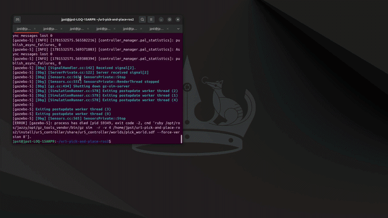
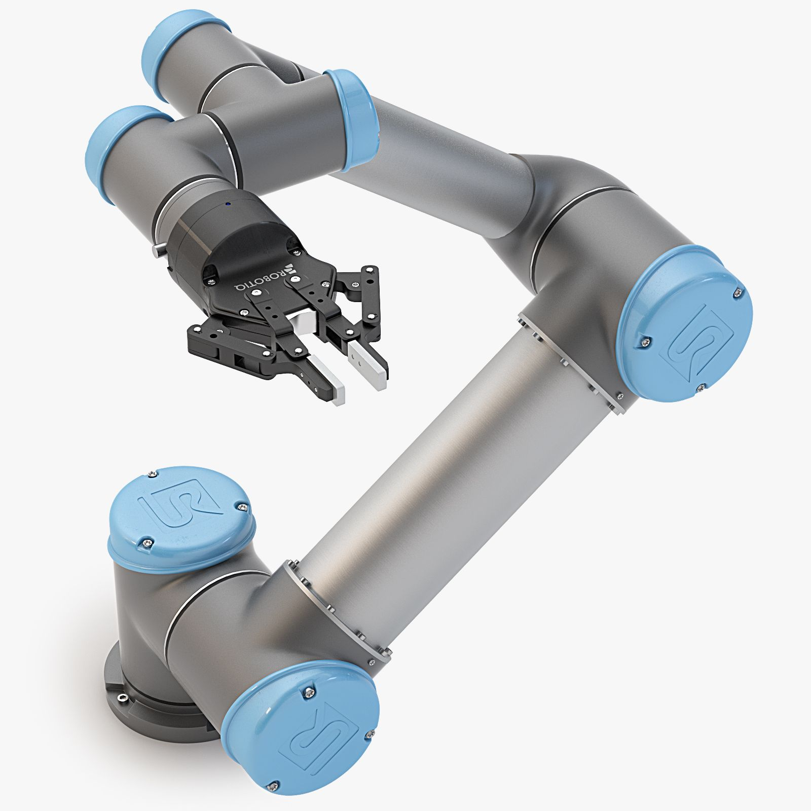

# Armbot_UR5

**Armbot_UR5** is an autonomous pick-and-place robotic system by **Azer Ben Ali**, using a **UR5 arm** with a **Robotiq gripper** in Gazebo simulation. The robot detects colored boxes on a table using a wrist-mounted camera, picks them up, and places them into corresponding bins by color.


---

## Features

- **Real-time color detection** — HSV-based segmentation for red and blue objects using OpenCV
- **Camera-to-world transformation** — Converts pixel coordinates to 3D world positions using camera intrinsics and TF2
- **Visual servoing** — Re-detects box from directly above before grasping for precise centering
- **Adaptive scanning** — Cycles through 10 different scan positions to overcome gripper occlusion blind spots
- **Intelligent pick ordering** — Sorts detected boxes by distance (nearest-first) to minimize collisions
- **Robust detection filtering** — Requires minimum 3 consistent readings and proximity-based re-detection to eliminate false positives
- **Autonomous operation** — Scans, detects, picks, places, and terminates without human intervention

---

## Demo



## Robot Mesh

The UR5 arm and Robotiq gripper mesh used by the project has the following appearance:



---

## System Architecture

```
┌─────────────┐    pixel coords     ┌────────────────┐    world coords     ┌─────────────────┐
│   Wrist     │ ──────────────────► │  Pixel to      │ ──────────────────► │  Pick and       │
│   Camera    │   /detected_objects │  World         │   /box_world_poses  │  Place          │
│  (Gazebo)   │                     │  Transform     │                     │  Controller     │
└─────────────┘                     └────────────────┘                     └─────────────────┘
      │                                    │                                       │
      │ image + camera_info                │ TF2 lookup                            │ MoveIt 2
      │                                    │                                       │
┌─────────────┐                     ┌────────────────┐                     ┌─────────────────┐
│  ros_gz     │                     │  TF2           │                     │  Gazebo         │
│  bridge     │                     │  (joint states)│                     │  Simulation     │
└─────────────┘                     └────────────────┘                     └─────────────────┘
```

---

## Project Structure

```
Armbot_UR5/
├── armbot_ur5/
│   ├── pick_and_place.py        # Main orchestration — scan, pick, place loop
│   ├── detect_objects.py        # HSV color detection with OpenCV
│   ├── pixel_to_world.py        # Pixel-to-world coordinate transformation
│   └── box_pose_bridge.py       # Gazebo pose bridge for box tracking
├── launch/
│   └── pick_and_place.launch.py # Launch file for pick-and-place node
├── config/
│   └── ur5_gripper_controllers.yaml  # UR5 controller configuration
├── urdf/
│   └── ur5_with_gripper.urdf.xacro   # UR5 + Robotiq gripper description
├── worlds/
│   └── pick_world.sdf           # Gazebo world with table, boxes, and bins
└── setup.py
```

---

## Prerequisites

- **Ubuntu 24.04**
- **ROS 2 Jazzy**
- **Gazebo Harmonic**
- **MoveIt 2**
- **Universal Robots ROS 2 packages** (`ur_simulation_gz`, `ur_moveit_config`)

### Install Dependencies

```bash
sudo apt install ros-jazzy-moveit ros-jazzy-ur-simulation-gz ros-jazzy-ros-gz-bridge
rosdep install --from-paths . --ignore-src --rosdistro jazzy -r -y
```

---

## Build

```bash
cd ~/Armbot_UR5
colcon build --packages-select armbot_ur5
source install/setup.bash
```

---

## Run

Open **6 terminals**. Run each command in order:

### Terminal 1 — Gazebo Simulation

```bash
cd ~/Armbot_UR5 && source install/setup.bash
ros2 launch ur_simulation_gz ur_sim_control.launch.py \
  ur_type:=ur5 \
  description_file:=$(ros2 pkg prefix armbot_ur5)/share/armbot_ur5/urdf/ur5_with_gripper.urdf.xacro \
  controllers_file:=$(ros2 pkg prefix armbot_ur5)/share/armbot_ur5/config/ur5_gripper_controllers.yaml \
  world_file:=$(ros2 pkg prefix armbot_ur5)/share/armbot_ur5/worlds/pick_world.sdf
```
`Wait at least 10 to 20 seconds before running next command`
### Terminal 2 — Camera Bridge

```bash
ros2 run ros_gz_bridge parameter_bridge \
  "/world/pick_world/model/ur/link/wrist_3_link/sensor/wrist_camera/image@sensor_msgs/msg/Image[gz.msgs.Image" \
  "/world/pick_world/model/ur/link/wrist_3_link/sensor/wrist_camera/camera_info@sensor_msgs/msg/CameraInfo[gz.msgs.CameraInfo"
```

### Terminal 3 — Object Detection

```bash
cd ~/Armbot_UR5 && source install/setup.bash
ros2 run armbot_ur5 detect_objects
```

### Terminal 4 — Pixel to World Transform

```bash
cd ~/Armbot_UR5 && source install/setup.bash
ros2 run armbot_ur5 pixel_to_world
```

### Terminal 5 — Pick and Place (run after Gazebo is fully loaded)

```bash
cd ~/Armbot_UR5 && source install/setup.bash
ros2 launch armbot_ur5 pick_and_place.launch.py
```

---

## How It Works

### 1. Scanning
The arm moves to a scan position above the table and collects 5 seconds of camera detections. It cycles through 10 different scan positions varying in both X and Y to overcome gripper occlusion.

### 2. Detection
The wrist camera captures images which are processed through HSV color segmentation. Red and blue contours are identified, filtered by area (100–15000 px²), and their pixel centroids are computed.

### 3. Coordinate Transform
Pixel coordinates are converted to 3D world coordinates using the camera intrinsic matrix and TF2 transforms between the camera optical frame and the world frame.

### 4. Visual Servoing
Before grasping, the arm moves directly above the target box and re-detects it. Only readings matching the target color within 5cm of the original detection are accepted. This corrects for perspective distortion from the initial scan angle.

### 5. Grasping & Placing
The arm descends to grasp height, closes the gripper (200N force), lifts the box, moves to the corresponding color bin, and releases. The system then rescans for remaining boxes.

### 6. Termination
The system stops when no boxes are detected for a full scan round, returns to the home position, and shuts down.

---

## Configuration

| Parameter | Value | File |
|-----------|-------|------|
| Grasp height | 0.68m | `pick_and_place.py` |
| Pre-grasp height | 0.72m | `pick_and_place.py` |
| Gripper force | 200N | `pick_and_place.py` |
| Detection area filter | 100–15000 px² | `detect_objects.py` |
| Min readings threshold | 3 | `pick_and_place.py` |
| Re-detection proximity | 5cm | `pick_and_place.py` |
| Max scan rounds | 10 | `pick_and_place.py` |
| Table Z height | 0.515m | `pixel_to_world.py` |

---

## World Setup

```
         y=-0.4 (Blue Bin)     y=0 (Table Center)     y=0.4 (Red Bin)
              ┌───┐                                        ┌───┐
              │ B │           ┌──────────────────┐         │ R │
              └───┘           │     🟥     🟥    │         └───┘
                              │     🟦     🟦    │
                              └──────────────────┘
                                   Table
                              ═══════════════════
                                  UR5 Base
```

- **4 boxes**: 2 red (x=0.45) + 2 blue (x=0.35), spaced 20cm apart in Y
- **2 bins**: Red bin at (0.2, 0.4), Blue bin at (0.2, -0.4)

---

## Tech Stack

| Component | Technology |
|-----------|-----------|
| Robot | Universal Robots UR5 |
| Gripper | Robotiq 2F-85 |
| Simulation | Gazebo Harmonic |
| Middleware | ROS 2 Jazzy |
| Motion Planning | MoveIt 2 (OMPL RRTConnect) |
| Vision | OpenCV (HSV segmentation) |
| Transforms | TF2 |
| Language | Python 3.10+ |

---

## Author and License

**Armbot_UR5** is authored by **Azer Ben Ali** and distributed under the [Apache License 2.0](LICENSE). The original copyright notice is retained in the license file.
